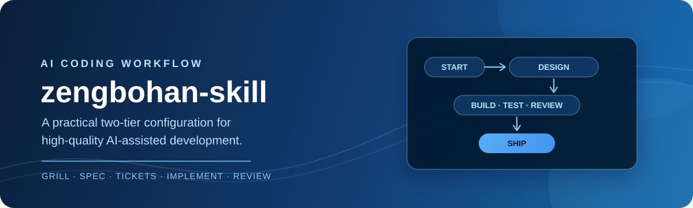

<p align="center">
  
</p>

<h1 align="center">zengbohan-skill</h1>

<p align="center">
  面向 AI 编码代理的自包含三层开发流水线 — 一个文件夹，零伴随技能。
</p>

<p align="center">
  <a href="LICENSE"></a>
</p>

<p align="center">
  <a href="README.md">English</a> | 简体中文
</p>

## 它做什么

`zengbohan-skill` 是显式调用的开发流程，适用于功能、修复和重构。按风险和复杂度选择档位，让流程投入和工作规模相称。

| 档位 | 适用 | 执行内容 |
| --- | --- | --- |
| **micro** | 错别字、文案等局部低风险改动 | 直接修改并做必要验证；不能只按代码行数判断 |
| **standard**（默认） | 范围明确的功能、修复和重构 | 检查代码 → 确认重要决策 → 批准一份计划 → 分切片实现和验证 → 评审 |
| **full** | 跨会话、多依赖或存在重大不确定性 | 先批计划内容，再批切片和依赖；分阶段实现和评审 |

standard 通常只需 **一次** 批准计划；full 分两次确认计划内容和切片。代理自行查询可获取的环境事实，只询问会影响范围、行为或风险的重要决策，并给出建议。鉴权、资金、迁移和数据完整性相关改动至少采用 standard，不以代码行数降档。

底下的四个阶段：

| 阶段 | 定义文件 | 做什么 |
| --- | --- | --- |
| 1 | `stages/interview.md` | 并行探索代码库，然后进行设计树访谈 — 不落盘任何东西 |
| 2 | `stages/plan.md` | 把决策综合成计划文件（故事、接缝、带 `Verify:` 行的切片）— 一次批准，full 模式则两道门 |
| 3 | `stages/implement.md` | 按切片实现并验证，记录进度；只有获得授权才提交 |
| 4 | `stages/code-review.md` | 检查规范与正确性、需求与实际行为，提供带证据的验收清单 |

入口文件（`SKILL.md`）负责选档与路由；阶段规则只存在于 `stages/`。阶段文件是普通 Markdown 文档，不是注册技能。

## 一次运行长什么样

```text
> /zengbohan-skill 给 RAG 问答链路加上引用溯源

zengbohan-skill · 档位：standard（一次批准，然后开工）

▍ 访谈   并行探索了 3 个区域；有 2 个决策需要你拍板：
         · 引用挂在哪里（答案 token 还是报告章节）？
         · 什么算一条溯源？→ 已给推荐方案
▍ 计划   .scratch/2026-09-30-citation-tracing.md — 3 个切片，
         各带 Verify: 行 · 批准后继续 (y/n)
▍ 实现   切片 1/3：生成器接缝先写失败测试 → 实现 →
         逐个验证；只有计划获准时才提交
▍ 评审   双轴评审（规范 + 计划还原度）→ 验收清单
         交回给你签字
```

技能在回复第一行说明档位和原因。它先写计划草稿，再请你批准；重要决策会等你确认，常规实现选择则继续推进。计划记录实现、验证、提交状态、证据和下一步，方便中断后恢复。评审也会检查任务相关的未提交改动。

## 技术栈

无运行时、无构建步骤、无依赖 — 技能就是纯 Markdown 加配套文件，打包成单个文件夹：

| 组成 | 说明 |
| --- | --- |
| `SKILL.md` | 入口 — 档位分发、路由、退出条件（YAML frontmatter：`name`、`description`） |
| `agents/openai.yaml` | Codex 技能选择器信息和显式调用策略 |
| `stages/*.md` | 四个阶段定义（规则只在这里） |
| `references/*.md` | 阶段引用的操作手册 |
| 遵循约定 | [Agent Skills](https://agentskills.io) — 任何扫描技能目录的宿主都会自动发现它 |

## 自包含设计

早期版本需要随本技能一起安装十个伴随技能。现在它们已 **内嵌并合并到 `stages/` 下**，任何宿主装这一个文件夹就够。没有别的东西要装，也不会再有东西失步。

## 安装

仓库根目录 **就是** 技能文件夹 — 直接克隆进技能目录即可。

### Claude Code

```bash
git clone https://github.com/zeng-bohan/zengbohan-skill.git ~/.claude/skills/zengbohan-skill
```

### ZCode

```bash
git clone https://github.com/zeng-bohan/zengbohan-skill.git ~/.zcode/skills/zengbohan-skill
```

### Codex

把整个文件夹安装到 Codex 的用户技能目录，再通过技能选择器或 `$zengbohan-skill` 显式调用：

```bash
git clone https://github.com/zeng-bohan/zengbohan-skill.git ~/.agents/skills/zengbohan-skill
```

随附的 `agents/openai.yaml` 会关闭隐式调用。不支持技能发现的宿主，则在指令中配置为仅在用户显式调用时读取 `SKILL.md` 和其引用的阶段文件。

### 其他宿主

技能是纯 Markdown 加配套文件。克隆到你的代理能读到的任何位置，然后在宿主的常驻指令文件里指向入口定义：

```markdown
When the user invokes the zengbohan-skill pipeline (e.g. "/zengbohan-skill <task>"),
read <path-to>/zengbohan-skill/SKILL.md and follow it.
```

Cursor rules、Windsurf、Cline、opencode，任何能注入指令的宿主都适用。

## 使用

```text
/zengbohan-skill 给 RAG 问答链路加上引用溯源
```

请求中可以写明需求、验收要求和执行限制，例如“不要提交或推送”。默认使用 standard；跨会话任务可指定 full。普通开发请求不会自动触发本技能。

## 注意事项与避坑

- **只认显式调用。** 技能不会在「develop」「按流程走」这类自然语言触发词上自动启动 — 想走流水线，请按名字调用。
- **装完要重启。** 技能没有立即出现的话，重启或刷新你的宿主。
- **Windows 路径。** 把上面所有路径里的 `~/` 换成 `%USERPROFILE%\`。
- **一个产物，不是一堆文书。** 流水线只产出唯一一个文件 — `.scratch/` 下的计划；其余都在对话里。没有术语表、ADR、规格文档或票务清单。
- **授权边界清楚。** 批准计划本身不代表授权提交、推送、部署或写入线上数据库。
- **验收看证据。** 本地检查不能替代所需的部署、联调或设备验收。
- **注册的技能只有一个。** 只有顶层 `SKILL.md` 叫这个名字；阶段文件是普通 Markdown，宿主只会注册一个技能。
- **上游技能不内嵌。** `triage`、`prototype`、`pr`、`diagnosing-bugs`、`wayfinder`、`wizard` 等持续增长的 mattpocock 技能刻意不收 — 需要就从 [mattpocock/skills](https://github.com/mattpocock/skills) 安装。

## 仓库结构

```text
zengbohan-skill/          ← 仓库即技能；把这个文件夹克隆进技能目录
├── SKILL.md              ← 入口 — 档位分发 + 路由 + 退出条件
├── agents/
│   └── openai.yaml       ← Codex 技能选择器信息和调用策略
├── AGENTS.md
├── LICENSE
├── docs/
│   └── banner.svg
├── stages/               ← 四个阶段定义（规则只在这里）
│   ├── interview.md
│   ├── plan.md
│   ├── implement.md
│   └── code-review.md
└── references/           ← 阶段引用的操作手册
    ├── PHASE-BOUNDARIES.md
    ├── tests.md
    └── mocking.md
```

## 设计原则

- **先设计后编码。** 把重要决策显式化 — 且只显式化重要的。
- **仪式感随工作量伸缩。** 门槛与流程按功能大小体现价值；一天的功能配一次批准，而不是一套自己的文书流程。
- **一个产物，不是一堆文书。** 流水线只产出唯一一个文件 — `.scratch/` 下的计划；其余都在对话里。
- **交付垂直切片。** 每个切片都应可独立验证。
- **测接缝。** 优先写打在真实边界与失败模式上的测试。
- **有证据才加复杂度。** 代码库配得上时才动用架构与诊断工具。

## 致谢

阶段定义整合自 Matt Pocock 的工程技能套件（[mattpocock/skills](https://github.com/mattpocock/skills)）— `grilling`、`domain-modeling`、`grill-with-docs`、`to-spec`、`to-tickets`、`implement`、`tdd`、`code-review`、`setup-matt-pocock-skills` 与 `ask-matt` 的阶段边界规则 — 最后同步于 2026-09-24。上游还在持续增长（`triage`、`prototype`、`pr`、`diagnosing-bugs`、`wayfinder`、`wizard`……）；这些刻意 **不** 内嵌 — 需要请从 mattpocock/skills 安装。打包、整合、三层流程与自包含单入口设计由 Bohan Zeng 完成。

## 贡献

个人维护项目。Bug、问题与功能建议：[提 Issue](https://github.com/zeng-bohan/zengbohan-skill/issues)。

## 许可证

[MIT](LICENSE) © 2026 Bohan Zeng
